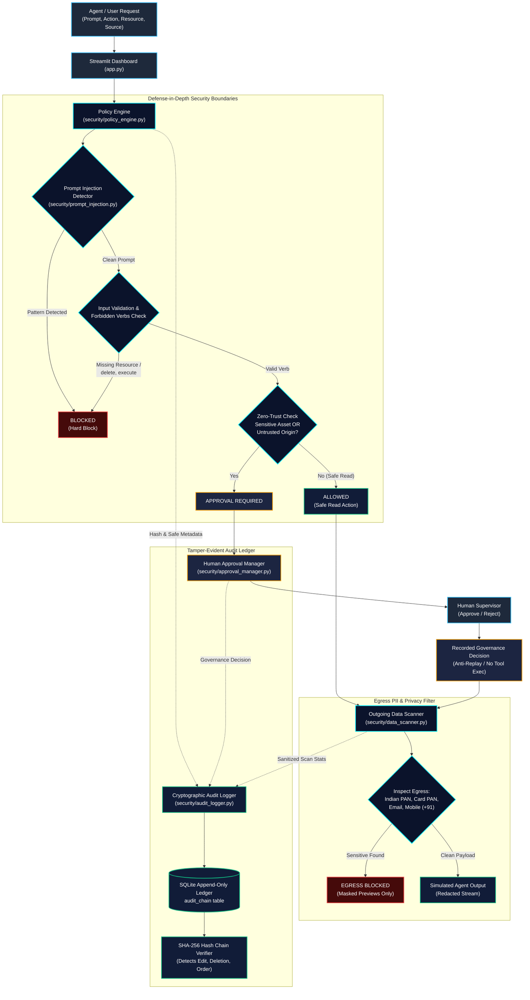

# 🏛️ Agent Guardrail Firewall: System Architecture

> Comprehensive architectural specification, component interactions, trust boundaries, and cryptographic verification flow.

---

## 1. System Architecture Diagram

---

## 2. Component Breakdown

### 1. User Interface Layer (`app.py`)
- **Technology:** Streamlit with custom CSS cybersecurity theme (`#0B132B` navy and `#00F0FF` cyan accents).
- **Responsibilities:**
  - Coordinates user input, preset simulation scenarios, and interactive inspection.
  - Maintains deterministic session state across reruns.
  - Enforces safe reset controls that only clear demo data without modifying system files.
  - Displays real-time metrics, decision cards, and audit chain integrity status.

### 2. Heuristic Prompt Injection Detector (`security/prompt_injection.py`)
- **Technology:** Compiled regular expressions (`re.IGNORECASE`).
- **Target Patterns:**
  - **Instruction Overrides:** `ignore all previous instructions`, `forget what you were told`.
  - **Secret Probing:** `reveal system prompt`, `leak api_key`, `dump credentials`.
  - **Jailbreak Personas:** `DAN mode`, `developer mode enabled`, `pretend you have no rules`.
  - **Delimiter Attacks:** `<|im_start|>`, `--- BEGIN SYSTEM PROMPT ---`.
- **Limitation Notice:** Explicitly documented as a first-line heuristic defense; semantic and multi-turn adversarial attacks require layered classifier models.

### 3. Zero-Trust Policy Engine (`security/policy_engine.py`)
- **Decision Hierarchy:**
  1. **Validation:** Rejects empty resources or unrecognized verbs (`BLOCKED`).
  2. **Injection Defense:** If prompt injection is flagged, returns `BLOCKED` with `is_hard_block=True`.
  3. **Forbidden Actions:** Destructive operations (`delete`, `execute`, `drop`, `kill`, `rm`) return `BLOCKED` with `is_hard_block=True`.
  4. **Sensitive Asset & Origin Escalation:** Resources matching sensitive keywords (`salary`, `credential`, `secret`, `contract`) or origins marked untrusted return `APPROVAL REQUIRED`.
  5. **Pre-Approved Safe Actions:** Safe read operations (`read`, `search`, `query`, `summarize`, `view`) on non-sensitive assets from trusted sources return `ALLOWED`.
  6. **Default-Deny:** Any unclassified neutral action defaults to `APPROVAL REQUIRED`.

### 4. Human Approval Manager (`security/approval_manager.py`)
- **Invariants Enforced:**
  - **Hard-Block Non-Override:** Requests with `is_hard_block=True` cannot be approved under any circumstance.
  - **Anti-Replay:** Concurrency-locked state ensures a request cannot be processed more than once.
  - **Simulated Scope:** Approval records an audit authorization; it does not execute live operating system commands.

### 5. Outgoing Data Scanner (`security/data_scanner.py`)
- **Detection Capabilities:**
  - Indian Permanent Account Number (PAN): `\b[A-Za-z]{5}[0-9]{4}[A-Za-z]{1}\b`
  - Payment Card 16-Digit PAN: `\b(?:\d{4}[ -]?){3}\d{4}\b`
  - Email Addresses: `\b[a-zA-Z0-9_.+-]+@[a-zA-Z0-9-]+\.[a-zA-Z0-9-.]+\b`
  - Indian Mobile Numbers: `\b(?:\+91[\-\s]?|91[\-\s]?|0)?[6-9]\d{9}\b`
- **Privacy Mechanism:** Full sensitive values are never logged or exposed in the UI. Only masked previews (e.g. `AB****34F`, `s***@domain.com`, `+91 98****3210`) and sanitized redactions are emitted.

### 6. Cryptographic Audit Logger (`security/audit_logger.py`)
- **Technology:** SQLite3, standard library `hashlib` (SHA-256).
- **Mathematical Hash Chaining:**
  $$\text{record\_hash}_i = \text{SHA256}(\text{id}_i \parallel \text{timestamp}_i \parallel \text{event\_type}_i \parallel \text{request\_id}_i \parallel \text{action}_i \parallel \text{decision}_i \parallel \text{details\_json}_i \parallel \text{record\_hash}_{i-1})$$
  - Genesis Record: $\text{previous\_hash}_0 = 0000000000000000000000000000000000000000000000000000000000000000$.
- **Tamper Detection Capabilities:**
  - Content Alteration: Changing any field invalidates $\text{record\_hash}_i$.
  - Link Breakage: Inserting or deleting an interior record breaks $\text{previous\_hash}_{i+1}$.
  - Sequence Gap: Deleting any row creates an ID discontinuity.
  - Order Swapping: Changing row order breaks sequential cryptographic hashes.
- **Privacy Guarantee:** Enforces Zero Raw Payload logging. Raw prompts, emails, and PANs are stripped and converted to SHA-256 digests and lengths before database insertion.

---

## 3. Trust Boundaries & Security Model

| Boundary | Inbound Untrusted | Gateway Defense | Internal Safe State |
| :--- | :--- | :--- | :--- |
| **Agent Prompt Input** | Arbitrary text from users or web scrapes | Heuristic regex detector | Only sanitized prompt hash stored in audit |
| **Tool Execution** | Arbitrary tool execution requests | Zero-trust verb and asset rules | Destructive verbs hard-blocked; sensitive actions queued |
| **Human Review** | Potential rogue supervisor override | Invariant check in approval manager | Hard-blocks can never be approved |
| **Agent Egress** | Raw output payloads from LLM/tools | Outgoing PII / PAN / Email scanner | Payloads masked, redacted, or blocked |
| **Database Persistence** | Database file access | SHA-256 cryptographic chaining | Any retroactive modification detected immediately |
